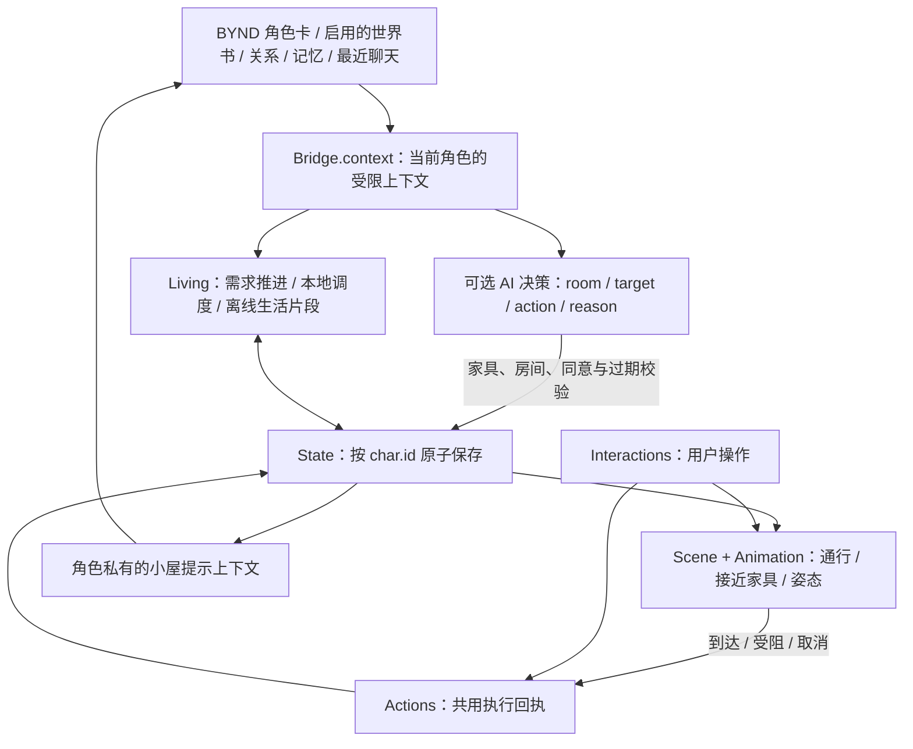

# 小屋生活与 BYND 角色状态

图中的结构可以沿现有模块实现，不另建一份角色卡、聊天或记忆数据库。角色身份以通讯录 `char.id` 为唯一关联键，小屋保存空间布局、需求和生活进度；渲染器执行动作，AI 只提供受校验的意图。

## 当前已接通

| 责任 | 实现与边界 |
| --- | --- |
| 共用身份与上下文 | `bridge.js` 读取当前角色卡、启用世界书、关系、记忆、最近聊天、手机和生活世界相关事件。世界书最多 12 条 / 3000 字，保持原有角色范围。 |
| 需求与行为 | `living.js` 维护精神、舒适、饱腹、清洁、心情五项满足度（0–100）。夜间遵循睡眠安排，白天低需求优先选支持该动作的已开放家具，其次按性格、事件、时间安排。当前尚未把这些值显示成常驻游戏数值条。 |
| 时间推进 | 活跃时每 10 秒触发；已显示楼层按确认开始的实际动作积分，排队、走路、受阻不获得睡觉/吃饭的恢复收益。动作切换先结算上一段。长时间隐藏页面后切回，按最多 24 小时的本地模拟补算。 |
| 离线与恢复 | 再次入屋时最多补算 24 小时；最多留 48 条新片段、总记录最多 300 条。相同时刻重入不重复记录，设备时钟倒退不重复累计。离线片段标注“模拟记录”，不冒充真实完成的互动。 |
| AI 决策 | 用户点击“让 Ta 安排一会儿”后才调用聊天 API。动作、目标家具、房间、摆放位置均有白名单校验；不能自动选择拥抱。请求失败、切换角色、关闭/重进小屋、已有生活计划改变时，旧响应不得覆盖新状态。 |
| 3D 与家具互动 | `actions.js` 为自动计划和手动互动共用 `queued → walking → acting → finished / blocked / cancelled` 回执。`interactions.js` 和 Scene 负责各自的移动适配，到达后才原子保存日常与家具使用。切换意图、角色、会话后旧回调失效。持续同一动作不反复起身或重复计数。首次显示/恢复场景经过座位与占用校验后恢复姿态，记录为已开始。 |
| 角色偏好 | 点人物 → **生活偏好**，分别确认阅读、游戏、音乐、园艺、下厨。资料中的喜好只是待确认线索；保存按角色隔离，下一次安排参考，正在进行的活动保留到原定结束。低需求和作息优先，偏好仅选择已存在的可用家具。 |
| 本地事件收件箱 | `life-context.js` 汇入该角色最近聊天、手机使用与已知生活事件，记录来源、稳定 ID、时间和消费回执。生活世界的结构化接口沿用原知识范围过滤。每角色保留 60 条动态、240 个去重 ID 和各来源时间游标；旧快照不重新消费，未来事件不提前消费。同步与计划同一次保存。无自动消息、帖子或新增后台 API 调用。 |
| 可查看的执行状态 | 点人物 → **生活动态** 查看开始、结束、取消、受阻及原因；展开“带回小屋的动态”查看本地参考来源。状态条展示执行回执，聊天提示区分计划、执行与模拟。最多保留 80 条状态变化回执。 |
| 聊天与论坛读取 | `getByndHomeLifePrompt(char)` 已接入聊天 API 和单角色生活世界上下文。小屋未加载 WebGL 时也能读取该角色的存档。小屋状态是角色私有上下文，不自动广播给通讯录或论坛。 |
| 持久化 | 需求、活动、家具状态、记录使用一次 `State.withHome` 保存；失败时旧存档完整保留并报告错误。渲染帧不做逐帧存储、也不逐帧调用 AI。 |

## 执行边界与下一阶段

### 家具的共同使用

- 沙发支持并肩坐、看书、看电视和看手机；电视会寻找两个朝向屏幕的真实座位；餐桌支持一起吃饭、喝东西；床支持一起睡觉、醒着躺卧。单人座椅及洗浴、如厕等个人设施保留单人动作。
- `Rooms.sharedActions/sharedAnchors` 统一定义共享能力及位置；菜单不把单人吃饭标成“一起吃饭”。`Scene.interactPair` 先验证两条路线、不同的等候落点，再分别行走，到齐才进入姿态。恋人餐桌互喂和同床依偎沿用实际距离、骨骼可达性与亲密许可检查。
- 跨楼层时先一起走到楼梯口再上楼。若同住角色在另一层，用户先去叫对方，再同行返回家具。相机浏览楼层不移动人物。共同互动期间自动生活安排不替换正在执行的姿态。
- 两个人共享 `groupId`，排队、开始及结束回执分别保留，但用一次存储事务更新。缺少第二个座位、路线受阻、旧回调及存储失败不能产生一半成功的记录。失败后释放人物；保留取消令牌以便存储恢复后重试清理。
- 全屋装修同时传递到花园、阳台、花房与露台的木作、坐垫、铺装、花盆、花朵和植物材质；保留原有材质分区和实例合批，不改花园布局或存档中的家具位置。

新增验证：`scripts/check-home3d-shared-browser.cjs` 覆盖双人到齐、实际座位、互喂/同床、跨层同行与邀约、取消、第二条路线失败、保存失败、两种人物洗澡动作、花园主题和 320/390/700px 工具栏；结果在 `artifacts/home3d-shared/`。

1. **未显示楼层仍是模拟。** 目前只运行人物所在画面的家具寻路；另一层的角色标为“本地模拟”，不伪造到达回执。人物上楼、加载另一层时恢复经过校验的姿态。后续若需全别墅持续物理模拟，须独立于相机加载各层导航与家具占用。
2. **事件消费是参考。** “已纳入生活安排参考”不代表一定触发对应动作，更不表示回复或发送完成。游标之前晚到的旧快照不会重新触发安排；如以后支持严格乱序事件，需要各来源提供可恢复的增量游标。
3. **对外行为独立授权。** 未来发消息、发帖或通知，接各应用自己的权限、审核、排队和失败反馈，不能由 3D 渲染器直接写聊天/论坛记录。
4. **自然表达。** 现有 AI 仍只在用户请求时解释和选择计划。更细致表情需要眼球/面部 blendshape 的正式角色资产，不能把头部朝向和眼睑遮罩当成完整表情系统。

## 门的素材与接入

- 已核对并使用 [Kenney Furniture Kit](https://kenney.nl/assets/furniture-kit) 的 CC0 `doorway` 和 `doorwayFront` 门扇几何；卧室木门和花园玻璃门保留原索引拓扑，映射为小屋的材质配色。
- 开放通道、厨房半高门、浴室磨砂移门由 BYND 原创，按空间用途分配。主通道保留宽门洞，门的外观不改寻路墙体或存档家具位置。
- 两个外部门扇分别 160 / 128 三角形；同步资源约 42 KB，无外部纹理、无需新增每帧加载。五种门型共用现有门的接近开合逻辑，浴室采用横向滑开。
- `assets/home3d/door-manifest.json` 保存来源、原文件与派生文件哈希和许可证；`scripts/prepare-home3d-doors.cjs` 可从官方压缩包重建。派生几何仅有一份 JS 资源，不额外打包相同 GLB/Base64 副本。
- 另核对了 [Quaternius Furniture Pack](https://quaternius.com/packs/furniture.html) 与 [Ultimate Furniture Pack](https://quaternius.com/packs/ultimatefurniture.html) 的 CC0 许可，本次没有将无关家具加入安装包。

验证：`node tests/run.cjs`；真实页面使用 `scripts/check-home3d-life-extension-browser.cjs`，覆盖动作到达、阻路、保存失败、偏好不打断当前动作、无后台 API、320px 屏宽和 47/59px 安全区（父容器预留/顶栏预留）。截图与报告位于 `artifacts/home3d-life-extension/`。原有手机返回小屋与门型验证保留在 `scripts/check-home3d-life-browser.cjs`。真实手机持续帧率与发热仍需设备测试。
